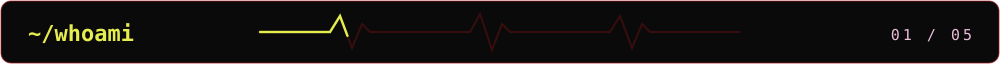
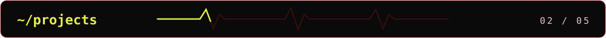
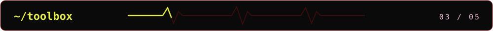
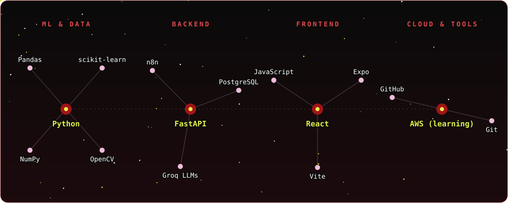
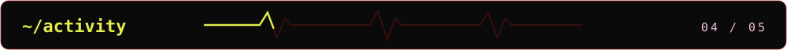
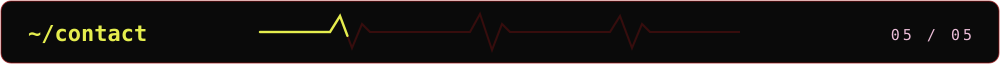

<i>I build AI that reads the world: satellite pixels, camera frames, mountain roads.</i>

  
  
  

<table>
  <tr>
    <td width="50%" valign="top">
      <code>01</code> · Alibaba Cloud AI Hackathon · National Final
      <h3><a href="https://github.com/ArishaArif/RouteLink">RouteLink</a></h3>
      
<b>An AI travel companion for Northern Pakistan.</b> Plans trips, flags road hazards with an ML model, and answers questions through an AI guide. My part: QA and integration.

      

        
        
        
        
      

    </td>
    <td width="50%" valign="top">
      <code>02</code> · LGU Smart City Hackathon
      <h3><a href="https://github.com/ArishaArif/LitterLapse">LitterLapse</a></h3>
      
<b>Litter detection from moving vehicles.</b> Spots litter on the road so cities can find and clean problem areas faster. Team of 4. My part: the AI/ML model.

      

        
        
      

    </td>
  </tr>
  <tr>
    <td width="50%" valign="top">
      <code>03</code> · NASA Space Apps 2026
      <h3><a href="https://github.com/Faizan-ctrl/GlacierWatch">GlacierWatch</a></h3>
      
<b>Early warning for glacial lake floods.</b> Combines radar, optical and elevation data to score lake risk in the Hindu Kush Himalaya, then sends alerts as Urdu voice messages.

      

        
        
        
        
      

      
    </td>
    <td width="50%" valign="top">
      <code>04</code> · Side project
      <h3><a href="https://github.com/Faizan-ctrl/convertly">Convertly</a></h3>
      
<b>A free file converter with no sign-up.</b> PDF to Word, image to PDF, PDF to images, and image to text with OCR.

      

        
        
      

    </td>
  </tr>
</table>

  
  

<b>Got a problem worth solving with AI? Let's talk.</b>

  
  

